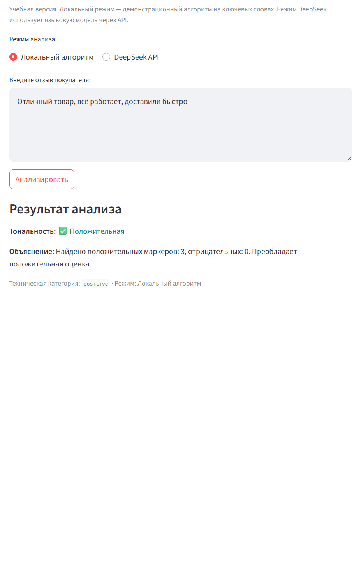

# AI Review Intelligence

Учебное приложение на Python + Streamlit для анализа тональности отзывов покупателей.
Поддерживает два режима: локальный алгоритм на ключевых словах и интеграцию с DeepSeek API.

## Демо

## Возможности

- Классификация отзыва: positive / neutral / negative
- Локальный режим — без сети и ключей (демонстрационный алгоритм)
- Режим DeepSeek API — с безопасным хранением ключа в .env
- Обработка ошибок API: тайм-ауты, 401/402/403/429, некорректный JSON, неверная категория
- Валидация ответа модели перед показом пользователю
- Тесты на локальный классификатор и на клиент API (с моками)
- CI на GitHub Actions

## Архитектура

app.py (Streamlit UI)
 ├── classifier.py        — локальный алгоритм
 └── deepseek_client.py   — клиент DeepSeek API (ключ из .env)

## Как запустить (Windows)

python -m venv .venv
.\.venv\Scripts\Activate.ps1
python -m pip install -r requirements.txt
python -m streamlit run app.py

Откройте http://localhost:8501.

## Настройка DeepSeek API (опционально)

1. Получите ключ на официальном сайте DeepSeek (раздел API).
2. Создайте локальный .env в корне проекта с DEEPSEEK_API_KEY=ваш_ключ.
3. .env уже в .gitignore — в Git не попадёт.

Без ключа приложение продолжает работать в локальном режиме.

## Тесты

python -m pip install -r requirements-dev.txt
python -m pytest tests/ -q

Тесты клиента DeepSeek используют моки — реальные запросы не выполняются.

## Ограничения локального классификатора

- Не понимает отрицаний (не плохо)
- Не учитывает морфологию
- Не распознаёт сарказм
- Простой счётчик вхождений, без весов

Это демонстрационный алгоритм, а не полноценная языковая модель.

## Roadmap

- [ ] Учесть отрицания и морфологию (pymorphy3)
- [ ] Пакетный анализ CSV
- [ ] Режим Ollama (локальная LLM без API-ключа)
- [ ] История анализов в сессии

## Статус

- Локальный режим: работает, покрыт тестами.
- Режим DeepSeek API: клиент готов, обработка ошибок и валидация покрыты моками; реальный запрос требует баланса DeepSeek API.

## Лицензия

Учебный проект.
